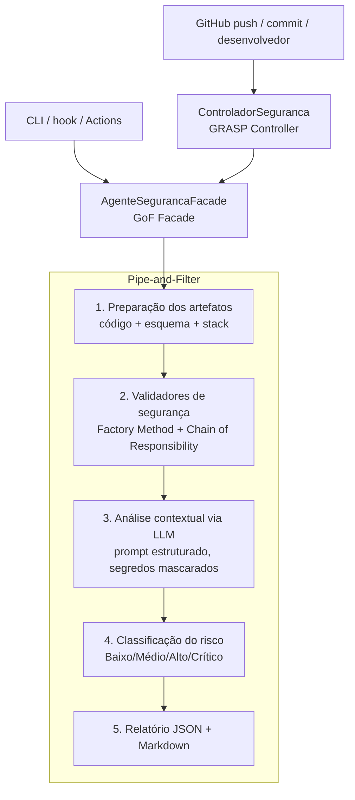

# Agente de Segurança

Agente **genérico e reutilizável** de auditoria de vulnerabilidades. Analisa o código-fonte e o esquema do banco de qualquer projeto, classifica cada problema em **Baixo / Médio / Alto / Crítico**, explica o impacto, recomenda a correção e gera um **exemplo de código corrigido**.

É **consultivo**: nunca bloqueia commits, pushes ou merges. No projeto atual (sistema acadêmico, ODS 4) ele roda dentro do backend Node.js/Express, mas funciona com qualquer repositório.

## O que ele analisa

| Categoria | Exemplos de verificação |
|---|---|
| Credenciais/Segredos | senha fixa no código, string de conexão com senha, `.env` versionado, tokens (AWS, GitHub, OpenAI), chave privada, `process.env.X \|\| 'padrão'` |
| SQL Injection | interpolação `${}` / f-string / concatenação em SQL, entrada do usuário na consulta, `multipleStatements` |
| Validação de entrada | `eval`/`new Function`, comandos de shell montados, path traversal, ausência de validação de esquema |
| Autenticação | MD5/SHA-1 em senhas, bcrypt com custo baixo, senha comparada com `===`, JWT sem expiração, `jwt.decode`, algoritmo `none`, cookie sem `httpOnly` |
| Autorização | rotas Express sem middleware de autenticação (escrita, leitura, admin), handlers Next.js sem sessão |
| Permissões | perfil/role vindo do `req.body`, mass assignment, possível IDOR |
| API | CORS aberto, sem helmet, login sem rate limit, erro interno exposto |
| Banco de dados | coluna de senha curta (texto puro), `GRANT ALL`, senha em `CREATE USER`, dados pessoais (LGPD) |

Funciona em JS/TS, Python, PHP, Java e outros (regras de framework só onde se aplicam).

## Uso rápido

```bash
cd agente-seguranca
npm install
cp .env.example .env          # opcional: LLM_API_KEY para a análise com ChatGPT

# sob demanda (projeto inteiro)
npm run analisar -- ..                 # ".." = raiz do repositório
npm run analisar -- .. --sem-llm       # só regras determinísticas
npm run analisar -- .. --profundo      # LLM também revisa arquivos sensíveis sem achados

npm test                               # 20 testes automatizados
```

O relatório é salvo em `<repositório>/relatorios-seguranca/` como **JSON** e **Markdown** (`ultimo.md` é sempre o mais recente). Adicione `relatorios-seguranca/` ao `.gitignore` do projeto.

## Acionamento

| Gatilho | Como |
|---|---|
| **A cada commit** | `npm run instalar-hook` → hook `post-commit` que roda em segundo plano (o commit não espera nem é bloqueado) |
| **A cada push** (inclui merges diretos) | copie `.github/workflows/agente-seguranca.yml` para `.github/workflows/` na raiz do repositório; o relatório aparece no resumo do job e como artefato. Opcional: secret `LLM_API_KEY` |
| **A cada push via webhook** | `POST /api/seguranca/webhooks/github` (assinatura HMAC com `GITHUB_WEBHOOK_SECRET`) |
| **Sob demanda** | CLI acima, ou `POST /api/seguranca/analises` |

### Integração no backend Express

```ts
import { criarRotasSeguranca } from './agente-seguranca/src/http/rotasExpress';

// registre ANTES de app.use(express.json()) — o webhook precisa do corpo bruto
app.use('/api/seguranca', criarRotasSeguranca());
app.use(express.json());
```

Ou como serviço separado, sem dependências: `npm run servidor` (porta 4010).

| Método | Rota | Proteção |
|---|---|---|
| GET | `/api/seguranca/status` | `Authorization: Bearer <SECURITY_AGENT_TOKEN>` |
| POST | `/api/seguranca/analises` — corpo `{ "arquivos"?: [...], "analiseProfunda"?: true, "usarLlm"?: false }` | Bearer |
| GET | `/api/seguranca/relatorios` e `/relatorios/:id` | Bearer |
| POST | `/api/seguranca/webhooks/github` | assinatura do GitHub |

Sem `SECURITY_AGENT_TOKEN` configurado as rotas respondem 503 (falha fechada).

## Arquitetura (como a especificação foi implementada)



| Especificação | Onde está no código |
|---|---|
| Pipe-and-Filter | `src/pipeline/Pipeline.ts` e `src/pipeline/filtros/*` |
| Factory Method (GoF criação) | `src/fabricas/FabricaAnalisadores.ts` — `criarAnalisadores()` em `FabricaNode` / `FabricaGenerica`; `RegistroFabricas` aceita novas stacks |
| Facade (GoF estrutural) | `src/facade/AgenteSegurancaFacade.ts` — único ponto de entrada (`analisar()`) |
| Chain of Responsibility (GoF comportamental) | `src/analisadores/AnalisadorSeguranca.ts` (handler) + 8 analisadores concretos |
| GRASP Controller | `src/controllers/ControladorSeguranca.ts` — recebe eventos, valida, delega à Facade |
| MVC parcial (sem View) | Model: `src/models/*` · Controller: `src/controllers/*` · apresentação textual: `src/apresentacao/*` |
| Base híbrida (regras + LLM) | regras: `src/analisadores/*` · LLM: `src/llm/*` + filtro 3 |
| Independente de outros agentes | nenhuma dependência externa; resultado em JSON padronizado para uso futuro por outros agentes |

### Regras + LLM

- As **regras determinísticas** sempre rodam e garantem resultados reproduzíveis.
- Com `LLM_API_KEY`, o **LLM** (ChatGPT ou qualquer API compatível com OpenAI via `LLM_BASE_URL`) recebe apenas os arquivos com achados (ou, no modo `--profundo`, também os sensíveis), com **segredos mascarados**, e devolve JSON com explicação contextual, código corrigido, possíveis falsos positivos e falhas de lógica novas.
- Regras de **confiança alta** não podem ser rebaixadas pelo LLM; nas demais, prevalece a avaliação contextual. Falsos positivos não são apagados: viram "Baixo" com observação.
- Se o LLM falhar ou não estiver configurado, o relatório sai só com as regras.

### Ajustes

- Falso positivo em uma linha: comentário `// seguranca-ignore` na própria linha ou na linha anterior.
- Pastas/arquivos a ignorar: `.segurancaignore` na raiz do projeto analisado (padrões glob, ex.: `tests/fixtures/`).
- Nova stack (ex.: regras de Django): crie um `AnalisadorSeguranca` e uma `FabricaAnalisadores`, e registre em `RegistroFabricas`.

## Estrutura

```
src/
  models/          Severidade, Vulnerabilidade, ContextoAnalise, RelatorioSeguranca
  analisadores/    Chain of Responsibility (8 analisadores)
  fabricas/        Factory Method por stack
  pipeline/        Pipeline + 5 filtros
  llm/             provedor OpenAI-compatível + prompts estruturados
  facade/          AgenteSegurancaFacade
  controllers/     ControladorSeguranca (GRASP)
  http/            adaptador Express e servidor HTTP autônomo
  apresentacao/    Markdown e persistência de relatórios
  cli.ts           linha de comando (commit, push, sob demanda)
tests/             testes + projetos de exemplo (vulnerável e seguro)
```
# AEP-Agente-de-Seguranca
